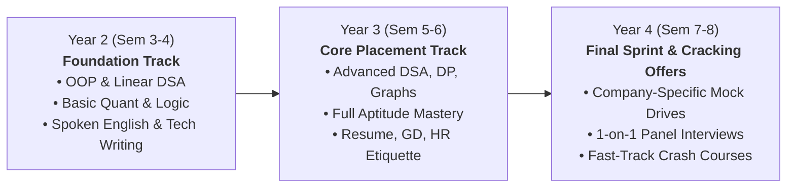
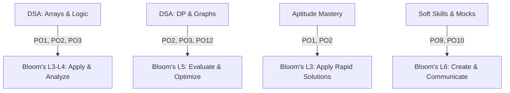

# CampusEdge Offering & Comprehensive Curriculum

This document outlines the multi-tier engineering and degree college placement training curriculum developed by **CampusEdge Learning Solutions**. It covers our 3 core pillars:
1. **Technical**: Data Structures, Algorithms, and System Foundations (in Java, C++, and Python)
2. **Aptitude**: Quantitative Aptitude, Logical Reasoning, and Verbal Ability
3. **Soft Skills**: Professional Communication, Group Discussions, Resume Engineering, and Mock Interviews

---

## 1. Year-Wise Progression Roadmap (Year 2 → Year 4)

Engineering institutions must introduce skill building incrementally across the academic life-cycle rather than cramming before Day-1 placement drives.

### Year 2: Foundation & Computational Logic (Semesters 3 & 4)
- **Target Audience**: 2nd Year B.Tech/B.E., BCA, B.Sc CS students.
- **Objective**: Overcome syntax hesitation, master time/space complexity analysis, build linear data structures from scratch, and develop mental math for quantitative speed.
- **Milestones**:
  - Write bug-free solutions for two-pointer, sliding window, recursion, and linked lists.
  - Solve 50+ basic problems on LeetCode/HackerRank.
  - Clear foundation aptitude benchmark test (>60% cutoff).

### Year 3: Placement-Ready Accelerator (Semesters 5 & 6)
- **Target Audience**: 3rd Year B.Tech/B.E., 2nd Year MCA students.
- **Objective**: Full syllabus coverage of high-frequency interview topics (Trees, BST, Heaps, Graph algorithms, Dynamic Programming, Greedy). Complete aptitude syllabus and soft skills grooming.
- **Milestones**:
  - Solve 200+ curated algorithmic problems across Easy, Medium, and Hard tiers.
  - ATS-compliant 1-page single column technical resume certified by CampusEdge mentors.
  - Pass 4 proctored campus placement simulation tests mirroring TCS Digital, Infosys SP, Cognizant GenC Next, and product company patterns.

### Year 4: Company-Specific Cram & Conversion (Semesters 7 & 8)
- **Target Audience**: Final Year students during campus recruitment season (July to February).
- **Objective**: Targeted prep for registered visiting companies (e.g., TCS NQT, Accenture Cognitive & Technical, Cognizant, Wipro, Capgemini, LTI Mindtree, Hexaware, Zoho, Amazon, Cisco).
- **Milestones**:
  - 1-on-1 technical and HR mock interviews with detailed rubrics.
  - Daily speed-tests on company-specific question banks.
  - Zero-day placement readiness with >85% Day-1 shortlist conversion.

---

## 2. Week-by-Week DSA Syllabus (16-Week Intensive Track)

- **Total Contact Hours**: 96 Hours (48 hrs interactive lecture + 48 hrs proctored hands-on coding lab).
- **Languages Supported**: Java (Collections / JDK 21), C++ (STL / C++20), Python (Python 3.11).

| Week | Core Module & Topics | Contact Hrs | Practice Problems (Difficulty: E / M / H) | Weekly Assessment Rubric |
| :--- | :--- | :---: | :--- | :--- |
| **01** | **Complexity Analysis & Arrays I** • Big-O, Big-$\Omega$, Big-$\Theta$ • In-place array operations • Prefix Sum, Kadane's Algorithm | 3h Lec 3h Lab | **Easy**: Two Sum, Best Time to Buy/Sell Stock **Med**: Maximum Subarray, Subarray Sum Equals K **Hard**: Trapping Rain Water | 10 MCQs (Complexity) + 2 coding tests (Array transforms) |
| **02** | **Arrays II & Two Pointers / Sliding Window** • Two-pointer technique • Variable & fixed-size sliding window • Dutch National Flag (3-way partition) | 3h Lec 3h Lab | **Easy**: Remove Duplicates, Move Zeroes **Med**: 3Sum, Container With Most Water, Longest Substring Without Repeating Characters **Hard**: Minimum Window Substring | 2 Coding problems (Sliding Window & Substring search) |
| **03** | **Searching & Sorting Algorithms** • Binary Search on monotonic functions • Search space reduction • QuickSelect & Merge Sort applications | 3h Lec 3h Lab | **Easy**: Binary Search, First Bad Version **Med**: Search in Rotated Sorted Array, Find Peak Element, Kth Largest Element **Hard**: Median of Two Sorted Arrays | 2 Coding problems + 10 dry-run trace MCQs |
| **04** | **Strings & Pattern Matching** • String immutability & memory internals • Rolling Hash & Rabin-Karp intuition • Anagrams, Palindromes, String Compression | 3h Lec 3h Lab | **Easy**: Valid Anagram, Valid Palindrome **Med**: Group Anagrams, Longest Palindromic Substring **Hard**: Shortest Palindrome / Edit Distance Primer | Coding test: 1 string hashing + 1 palindrome search |
| **05** | **Linked Lists (Singly, Doubly, Cyclic)** • Pointer manipulation without extra memory • Fast & Slow pointers (Floyd's Cycle detection) • Reversal in groups of K | 3h Lec 3h Lab | **Easy**: Reverse Linked List, Merge Two Sorted Lists **Med**: Linked List Cycle II, Add Two Numbers, Reorder List **Hard**: Reverse Nodes in k-Group | 2 Coding tests: In-place pointer mutation (No memory leaks) |
| **06** | **Stacks & Queues (Linear & Monotonic)** • Stack/Queue using arrays & nodes • Monotonic Stack (Next Greater Element) • Deque & Sliding Window Maximum | 3h Lec 3h Lab | **Easy**: Valid Parentheses, Implement Queue using Stacks **Med**: Next Greater Element II, Daily Temperatures, Min Stack **Hard**: Largest Rectangle in Histogram, Sliding Window Max | 2 Coding tests: 1 Monotonic stack + 1 Deque optimization |
| **07** | **Recursion & Backtracking** • Call stack internals & base cases • Subsets, Permutations, Combinations • Grid exploration (N-Queens, Sudoku) | 3h Lec 3h Lab | **Easy**: Subsets, Letter Combinations of Phone Number **Med**: Permutations, Combination Sum, Word Search **Hard**: N-Queens, Sudoku Solver | Proctored coding: Backtracking search with pruning |
| **08** | **Mid-Term Comprehensive Placement Simulation** • Full 90-minute timed mock test • Topics: Weeks 1 to 7 | 2h Eval 4h Review | 3 Coding Problems (1 Easy, 1 Medium, 1 Company-Tier Hard) + 20 Aptitude/CS Fundamental Questions | Sectional cutoff scorecard with individual benchmark rank |
| **09** | **Binary Trees & Traversals** • Tree representation & depth/height • BFS (Level order) & DFS (In/Pre/Post) • Lowest Common Ancestor & Tree Views | 3h Lec 3h Lab | **Easy**: Maximum Depth, Invert Binary Tree, Same Tree **Med**: Binary Tree Level Order, Diameter of Tree, LCA of Binary Tree **Hard**: Binary Tree Maximum Path Sum | 2 Coding tests: Tree reconstruction & Diameter calculation |
| **10** | **Binary Search Trees & Heaps / Priority Queues** • BST validation, insert, search, delete • Min-Heap / Max-Heap implementations • Top-K frequent elements & Two Heaps | 3h Lec 3h Lab | **Easy**: Kth Largest in Stream, Validate BST **Med**: Kth Smallest in BST, Top K Frequent Elements, Sort Characters by Frequency **Hard**: Find Median from Data Stream | 2 Coding tests: BST search invariants + Heap scheduling |
| **11** | **Greedy Algorithms & Divide and Conquer** • Greedy choice property & proof of correctness • Interval scheduling & meeting rooms • Fractional Knapsack & Huffman encoding | 3h Lec 3h Lab | **Easy**: Assign Cookies, Lemonade Change **Med**: Non-overlapping Intervals, Gas Station, Minimum Platforms **Hard**: Candy, Jump Game II | 2 Coding tests: Interval overlap & optimal resource scheduling |
| **12** | **Dynamic Programming I (1D DP)** • Memoization vs. Tabulation • Overlapping subproblems & optimal substructure • State definitions & transitions | 3h Lec 3h Lab | **Easy**: Climbing Stairs, House Robber **Med**: Coin Change, Longest Increasing Subsequence (LIS), Word Break **Hard**: Frog Jump, Decode Ways II | Coding test: 1D state transition + Space optimization to $O(1)$ |
| **13** | **Dynamic Programming II (2D & Grid DP)** • Grid paths & minimum path sums • 0/1 Knapsack & Unbounded Knapsack • Longest Common Subsequence (LCS) | 3h Lec 3h Lab | **Easy**: Unique Paths **Med**: Minimum Path Sum, 0/1 Knapsack, Longest Common Subsequence, Target Sum **Hard**: Edit Distance, Distinct Subsequences | 2 Coding tests: 2D DP matrix transitions |
| **14** | **Graphs I (Representations, BFS, DFS, Cycles)** • Adjacency List / Matrix • Connected components, bipartite graph • Topological Sort (Kahn's algorithm) | 3h Lec 3h Lab | **Easy**: Find if Path Exists, Flood Fill **Med**: Number of Islands, Course Schedule I & II, Rotting Oranges **Hard**: Word Ladder, Alien Dictionary | 2 Coding tests: Graph traversal & Cycle detection |
| **15** | **Graphs II (Shortest Paths & Disjoint Set Union)** • Dijkstra's Algorithm (Priority Queue) • Bellman-Ford & Floyd-Warshall overview • DSU (Union by Rank & Path Compression) | 3h Lec 3h Lab | **Easy**: Find the Town Judge **Med**: Network Delay Time, Number of Operations to Make Network Connected, Redundant Connection **Hard**: Cheapest Flights Within K Stops | 2 Coding tests: Dijkstra's pathfinding + DSU component tracking |
| **16** | **Tries, Bit Manipulation & Final Mock Placement Drive** • Prefix Tree implementation & Autocomplete • Bitwise XOR tricks, masks, subsets • Final 3-Hour Grand Placement Simulation | 3h Lec 3h Lab | **Easy**: Single Number, Implement Trie **Med**: Design Add and Search Words DS, Maximum XOR of Two Numbers **Hard**: Word Search II | Grand Final Exam: 3 Coding Challenges + Sectional Placement Readiness Index |

---

## 3. Aptitude Syllabus (Quantitative, Logical, Verbal)

- **Total Contact Hours**: 60 Hours (30 hrs Quantitative + 18 hrs Logical Reasoning + 12 hrs Verbal Ability).
- **Format**: High-speed shortcut methods, Vedic math mental calculations, option-elimination tactics, and company-specific question patterns.

### A. Quantitative Aptitude (30 Hours)
1. **Speed Mathematics & Number Systems** (4h): Divisibility rules, unit digits, remainders, LCM & HCF, power cycles, recurring decimals.
2. **Percentages, Profit & Loss, Discounts** (4h): Successive percentage changes, marked price vs. cost price, fraudulent dealer problems.
3. **Simple & Compound Interest** (3h): Annual, semi-annual compounding, difference between CI and SI, installment problems.
4. **Ratio, Proportion, Variation & Mixtures** (4h): Direct & inverse proportion, alligation rule, liquid replacement cycles.
5. **Time and Work & Pipes and Cisterns** (4h): Efficiency ratios, negative work, alternate-day work models.
6. **Time, Speed and Distance & Trains, Boats** (4h): Relative speed, average speed misconceptions, circular tracks, upstream/downstream.
7. **Permutations, Combinations & Probability** (4h): Fundamental counting principle, circular permutations, conditional probability, card & dice problems.
8. **Mensuration & Geometry Fundamentals** (3h): 2D/3D surface area and volume transformations, coordinate geometry basics.

### B. Logical Reasoning & Data Interpretation (18 Hours)
1. **Syllogisms & Deductive Logic** (3h): Venn diagrams, "Only a few", "Possibility" cases as tested by TCS and Infosys.
2. **Blood Relations & Coded Relationships** (3h): Family trees, direct statements vs. coded expressions.
3. **Linear & Circular Seating Arrangements** (4h): Single row, dual row facing, circular with inward/outward orientations.
4. **Coding-Decoding, Series & Analogy** (2h): Alphanumeric patterns, matrix-based coding.
5. **Direction Sense, Clocks & Calendars** (2h): Angle between hands, odd days calculation, shadow problems.
6. **Data Sufficiency & Analytical Puzzles** (4h): 2-statement and 3-statement data sufficiency, scheduling puzzles.

### C. Verbal Ability & Reading Comprehension (12 Hours)
1. **Grammar & Sentence Correction** (4h): Subject-verb agreement, modifiers, parallelism, tense consistency, prepositions.
2. **Vocabulary in Context & Fill in the Blanks** (2h): Connotations, collocations, phrasal verbs.
3. **Reading Comprehension & Critical Reasoning** (4h): Central idea identification, tone of the author, inference vs. assumption questions.
4. **Para Jumbles & Sentence Completion** (2h): Mandatory pairs, pronoun references, chronological sequence triggers.

---

## 4. Soft Skills & Corporate Readiness Syllabus

- **Total Contact Hours**: 36 Hours.
- **Delivery Mode**: Highly interactive, role-play driven, video-recorded feedback sessions.

| Module | Hours | Content & Activities | Measurable Learning Outcome |
| :--- | :---: | :--- | :--- |
| **Professional Communication & Email Etiquette** | 6h | • Voice modulation, corporate register, clarity • Professional emails (Leave, follow-up, meeting minutes) • Active listening & cross-cultural communication | Write flawless corporate emails; speak concisely using the PREP (Point, Reason, Example, Point) framework. |
| **Resume Engineering & LinkedIn Mastery** | 6h | • Single-page ATS-optimized resumes • Action verb bullet formulas (Google XYZ format) • LinkedIn profile optimization & recruiter networking | 100% of students attain an ATS score >85/100 and optimized LinkedIn presence. |
| **Group Discussion (GD) Dynamics** | 8h | • Current affairs, abstract topics, case studies • Initiating, moderating, handling interruptions • Body language & posture during heated debates | Participate in 3 simulated GDs with rubric scores on content, articulation, leadership, and emotional composure. |
| **Technical & HR Interview Preparation** | 8h | • "Tell me about yourself" structuring • Answering situational questions (STAR methodology) • Salary negotiation etiquette and asking questions to panel | Deliver structured STAR responses to behavioural questions with zero filler words. |
| **1-on-1 Mock Interviews with Industry Veterans** | 8h | • 30-minute individual simulated technical/HR rounds • Live whiteboard coding and resume cross-examination • Comprehensive written diagnostic report | Individual feedback report outlining technical depth, communication clarity, and candidate rating. |

---

## 5. Measurable Outcomes & NBA/NAAC Mapping

Every module is architected with clear Bloom's Taxonomy learning levels and mapped to NBA Program Outcomes (POs):

- **PO1 (Engineering Knowledge)**: Applied mathematics and data representation.
- **PO2 (Problem Analysis)**: Formulate asymptotic complexity bounds and algorithmic trade-offs.
- **PO3 (Design/Development)**: Write production-grade, bug-free implementations in Java/C++/Python.
- **PO9 (Individual and Team Work)**: Collaborative problem solving in hackathons and mock group discussions.
- **PO10 (Communication)**: Articulate technical architecture and behavioral narratives effectively.
- **PO12 (Life-Long Learning)**: Self-directed algorithmic mastery on competitive coding platforms.
