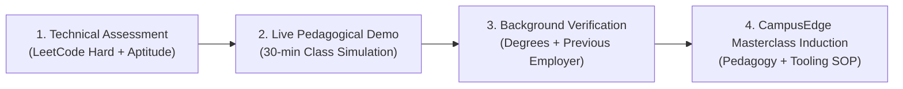

# CampusEdge Operational Standards & Quality Assurance (SOP)

This document establishes the Standard Operating Procedures (SOP) governing trainer hiring, instructional quality control, reporting formats, student feedback loops, and operational risk mitigation for **CampusEdge Learning Solutions**.

---

## 1. Trainer Onboarding & Screening SOP

To guarantee company-standard technical and pedagogical excellence, all trainers must pass a rigorous 4-stage screening gauntlet before setting foot in a partner college.



### Screening Rubric & Scoring

| Evaluation Phase | Objective & Assessment Standard | Minimum Qualifying Score |
| :--- | :--- | :---: |
| **Stage 1: Algorithmic & Aptitude Test** | Timed 90-minute proctored test: 3 LeetCode Medium/Hard algorithmic coding problems + 20 high-difficulty quantitative aptitude questions. | **85%** |
| **Stage 2: Pedagogical Simulation Demo** | 30-minute mock classroom teaching before our Academic Review Board on a complex topic (e.g., Dynamic Programming 0/1 Knapsack or Dijkstra's Algorithm). Evaluated on: conceptual clarity, board work, student engagement, patience, and elimination of jargon. | **4.2 / 5.0** |
| **Stage 3: Verification & Reference Check** | Formal verification of educational qualifications (B.Tech/M.Tech/MCA), minimum 3 years of software engineering or premier institutional training experience, and clean police/character conduct. | **Mandatory Pass** |
| **Stage 4: CampusEdge Standard Induction** | 3-day intensive onboarding covering: our 20-80 active learning method, LMS and attendance tracking tools, TPO communication boundaries, and classroom discipline protocols. | **Certified** |

---

## 2. Instructional Quality Assurance (QA)

Instructional quality is monitored on a continuous, data-driven basis:

1. **Random Mystery Audits**: A Senior Academic Director drops in unannounced on 10% of in-person and hybrid lectures each week to evaluate delivery rhythm, adherence to syllabus, and student participation.
2. **Real-Time Leaderboard Tracking**: TAs ensure that at least 80% of students submit working code for assigned lab problems before leaving the session.
3. **Trainer Red-Flag Escalation Protocol**:
   - If a trainer’s bi-weekly student rating dips below **4.0 / 5.0**, an immediate pedagogical mentor is dispatched.
   - If the rating does not recover above 4.2 within 7 calendar days, the trainer is replaced under our **Guaranteed Trainer Replacement SLA** within 48 hours at zero extra charge to the college.

---

## 3. Weekly Attendance & Assessment Reporting Format

Every Monday at 9:00 AM, the TPO and Principal receive an automated Executive MIS report structured as follows:

```
========================================================================================
CAMPUSEDGE EXECUTIVE PLACEMENT PROGRESS REPORT (WEEKLY MIS)
Institution: Vidyapeeth Institute of Technology | Academic Year: 2026-27
Cohort: 3rd Year B.Tech (CSE, IT, ECE) | Enrolled: 240 Students (4 Batches)
Reporting Window: Week 6 (Stacks, Queues, Syllogisms & Resume Engineering)
========================================================================================

1. ATTENDANCE METRICS
----------------------------------------------------------------------------------------
Batch        Scheduled Hours    Delivered Hours    Enrolled    Avg Attendance %    Defaulters (<75%)
CSE-A             6h                 6h               60            94.2%                 2
CSE-B             6h                 6h               60            91.6%                 4
IT-A              6h                 6h               60            93.8%                 3
ECE-A             6h                 6h               60            88.5%                 6
----------------------------------------------------------------------------------------
OVERALL:         24h                24h              240            92.0%                15

2. ASSESSMENT SUMMARY (WEEK 6 LAB TEST: 2 CODING PROBLEMS + 15 MCQs)
----------------------------------------------------------------------------------------
Batch        Test Takers    Pass Rate (>60%)    Batch Avg Score    Top Performer
CSE-A            58               84.5%              74.2%         Aditya Sharma (98%)
CSE-B            57               78.9%              70.8%         Neha Kulkarni (94%)
IT-A             58               81.0%              72.4%         Rohan Verma (96%)
ECE-A            55               67.3%              63.5%         Priya Nair (88%)

3. ACTIONABLE REMEDIATION FOR THIS WEEK
----------------------------------------------------------------------------------------
- ECE-A showed difficulty with Monotonic Stacks. A complimentary 2-hour Saturday lab clinic
  has been scheduled with Lead TA.
- 15 attendance defaulters have been notified via WhatsApp and list shared with TPO desk.
========================================================================================
```

---

## 4. Bi-Weekly Student Feedback Survey Form

Students submit an anonymous bi-weekly evaluation via the CampusEdge student app on a 5-point Likert Scale (1 = Strongly Disagree, 5 = Strongly Agree):

1. **Conceptual Clarity**: *"The trainer explained difficult algorithmic concepts and mathematical formulas in an easy-to-understand manner."*
2. **Pace of Delivery**: *"The speed of teaching was appropriate and allowed me to grasp concepts and take notes."*
3. **Lab Problem Relevance**: *"The practice problems solved in class match real placement test questions from TCS, Infosys, Cognizant, and product companies."*
4. **Doubts Resolution**: *"The trainer and teaching assistants answered my questions and helped debug my code patiently."*
5. **Classroom Engagement**: *"The session was interactive and kept me motivated throughout the scheduled hours."*
6. **Overall Recommendation**: *"I would recommend this training track to my juniors."* (Yes / No / Maybe)
7. **Open Qualitative Feedback**: *"What is one specific improvement you would like in the next 2 weeks?"*

---

## 5. Operational Risk Register & Mitigation Matrix

| # | Risk Event | Likelihood | Impact | Proactive Mitigation Strategy |
| :-: | :--- | :---: | :---: | :--- |
| **R1** | **Trainer Illness or Emergency Absence** | Medium | High | CampusEdge maintains a **15% stand-by bench** of pre-certified lead trainers in every region. A certified substitute is deployed within 2 hours or sessions are conducted seamlessly via our high-definition interactive hybrid studio. |
| **R2** | **College Exam Postponement / Timetable Shifts** | High | Medium | All schedules include 15% buffer hours. CampusEdge provides a flexible makeup window during weekends, semester breaks, or extended evening sessions at zero penalty. |
| **R3** | **College Lab Infrastructure Failure (Power / Internet)** | Medium | High | CampusEdge provides pre-packaged offline Docker/container environments and local server mirrors with all question banks pre-loaded, requiring zero internet for local execution. |
| **R4** | **Student Attendance Attrition in Later Weeks** | Medium | Medium | Automated daily WhatsApp attendance alerts sent to students and parents/mentors; biometric or digital QR sync with college attendance records; mandatory 80% attendance requirement to receive placement hall-ticket clearances. |
| **R5** | **Delayed Invoice Clearance by College Accounts** | Medium | Medium | Clear 3-stage milestone invoicing linked to deliverable reports; dedicated relationship manager conducts monthly accounts sync; 30-day grace period with unhindered student training continuity. |
