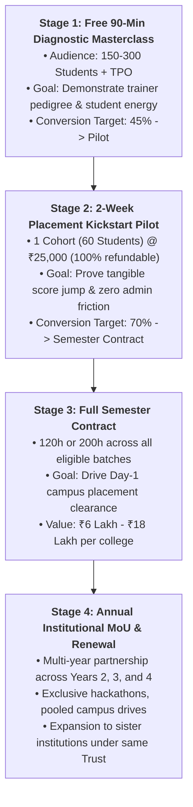

# The CampusEdge Institutional Pilot-to-Contract Funnel

Winning enterprise B2B partnerships with Indian engineering and degree colleges requires navigating multiple institutional stakeholders: the Training and Placement Officer (TPO), the Heads of Department (HoDs), the Dean of Academics, the Principal, and the Chairman/Managing Trustee.

This document details the **4-stage sales funnel** that transitions cold institutions into multi-year recurring institutional contracts.

---

## The 4-Stage Institutional Funnel

---

## Detailed Stage Playbooks & Conversion Gates

### Stage 1: Free 90-Minute Placement Diagnostic Masterclass

- **Entry Condition**: TPO or Principal responds to cold outreach or visits the CampusEdge website.
- **Activity**:
  - A high-energy, 90-minute live interactive session titled: *"Demystifying Modern Campus Hiring: How to Crack 7+ LPA Coding & Aptitude Rounds in 2026"*.
  - Held in the college auditorium or hybrid online lab.
  - Live problem dissection (e.g., solving Two-Sum to Sliding Window in 3 minutes without brute force).
  - Administration of the 20-minute **CampusEdge Student Readiness Assessment**.
- **Institutional Audience**: 150 to 300 pre-final / final year students, TPO, HoD CSE/IT, and faculty placement coordinators.
- **Success Metrics (Exit Gate)**:
  - Student Net Promoter Score (NPS) > +65.
  - TPO observes first-hand student engagement and diagnostic report identifying baseline weaknesses.
- **Call-to-Action**: TPO signs work order for the 2-Week Paid Pilot.

---

### Stage 2: 2-Week Placement Kickstart Pilot (The "Trojan Horse")

- **Duration & Scope**:
  - 20 Contact Hours over 10 working days (2 hours/day).
  - 1 Cohort of 60 students selected by the college.
  - Modules: High-yield DSA patterns (Sliding Window, Binary Search, Linked Lists) + Quantitative Aptitude Shortcuts + 1-page ATS Resume Workshop.
- **Pricing & Risk Reversal**:
  - **₹25,000 flat + GST**.
  - **100% Offset Guarantee**: 100% of this fee is credited against the full semester contract.
- **Operational Cadence**:
  - Pre-assessment test on Day 1; post-assessment simulation test on Day 10.
  - Daily WhatsApp update sent to the TPO with attendance logs.
  - Formal presentation of the Pilot Impact Dossier to the Principal and Dean on Day 12.
- **Success Metrics (Exit Gate)**:
  - Average student score improvement of $\ge 35\%$ between pre- and post-tests.
  - Student attendance retention $\ge 90\%$.
  - Formal student feedback rating $\ge 4.4$ out of 5.0.
- **Conversion Trigger**: The TPO and Principal receive a complete diagnostic audit proving that without structured training, 60% of students will fail upcoming placement drives.

---

### Stage 3: Full Semester Contract (120h – 200h Institutional Deployment)

- **Scope & Delivery**:
  - Rollout across all eligible 3rd and/or 4th year branches (CSE, IT, ECE, EEE, MCA).
  - Typically 3 to 6 batches (180 to 360+ students).
  - Integrated into the college weekly academic schedule or intensive vacation bootcamp.
- **Contract Value**:
  - Typically **₹6,00,000 to ₹18,00,000 + GST** depending on student strength and chosen package (Campus Foundation or Placement-Ready Accelerator).
  - Standard payment milestones: 30% advance, 40% mid-term, 30% completion.
- **Deliverables**:
  - Dedicated on-campus lead trainers and lab TAs.
  - Weekly Monday Morning MIS reports sent to leadership.
  - NAAC / NBA Criterion 5 compliance dossier prepared by CampusEdge.
  - Verified digital credentials issued to all eligible students.
- **Success Metrics (Exit Gate)**:
  - Overall placement rate increase $\ge 25\%$ compared to the previous graduating batch.
  - Day-1 recruiter clearance rate $>65\%$.
  - College management satisfaction score $\ge 9/10$.

---

### Stage 4: Annual Institutional Partnership MoU & Network Expansion

- **Scope & Duration**:
  - Formal 1-year or 3-year renewable Memorandum of Understanding (MoU).
  - Multi-year progressive curriculum: CampusEdge trains Year 2 (Foundation), Year 3 (Accelerator), and Year 4 (Mock Drives).
  - CampusEdge co-hosts campus hackathons and introduces corporate recruiters to the college.
- **Expansion Triggers**:
  - When an educational trust operates multiple colleges (e.g., engineering, polytechnic, arts & science, sister campuses across cities), winning one campus opens the gateway to group-wide contracts.
  - Typical group-level contract value: **₹25 Lakh to ₹50+ Lakh per annum**.
- **Retention Strategy**:
  - Annual curriculum review meeting with Academic Council.
  - Priority trainer reservation for the college's preferred calendar slots.
  - Complimentary Faculty Development Programs (FDPs) on Generative AI and modern software engineering for college professors.
