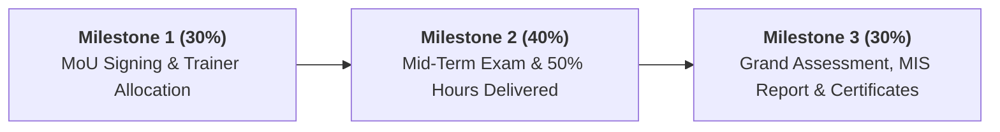

# CampusEdge Commercial Structure & Pricing Economics

This document outlines the commercial framework, pricing schedules in Indian National Rupees (INR), tax compliance considerations, pilot offers, payment milestones, and unit economics for **CampusEdge Learning Solutions**.

---

## 1. Commercial Pricing Models (INR)

Colleges may procure CampusEdge training under either of two institutional models:
1. **Per-Student Model**: Ideal for optional/elective batches, student-funded programs, or variable student cohorts.
2. **Fixed Institutional Batch Model**: Ideal for college-funded, mandatory training integrated into the academic timetable.

### A. Per-Student Pricing Schedule

| Package | Total Hours | Price per Student (Excl. GST) | Effective Cost per Hour | Minimum Cohort Size |
| :--- | :---: | :---: | :---: | :---: |
| **1. Campus Foundation** | 120 Hours | **₹3,500** | ₹29.17 / hr | 60 Students |
| **2. Placement-Ready Accelerator (Flagship)** | 200 Hours | **₹5,500** | ₹27.50 / hr | 60 Students |
| **3. Premium Mentorship & Product Incubator** | 300 Hours + Mocks | **₹8,500** | ₹28.33 / hr | 30 Students |

*Note: For large volume partnerships (>300 students across branches), institutional volume discounts of 10% to 15% are applicable upon Dean/Director approval.*

### B. Institutional Fixed Batch Pricing (Batch of 60 Students)

| Package | Standard Batch Fee (60 Students) | Discounted Tier-2/3 Institutional Rate | Cost per Student |
| :--- | :---: | :---: | :---: |
| **Campus Foundation (120h)** | ₹2,10,000 + GST | **₹1,80,000 + GST** | ₹3,000 |
| **Placement-Ready Accelerator (200h)** | ₹3,30,000 + GST | **₹2,85,000 + GST** | ₹4,750 |
| **Premium Mentorship (300h - 35 Students)** | ₹2,97,500 + GST | **₹2,45,000 + GST** | ₹7,000 |

---

## 2. Low-Risk Pilot Offer: "Placement Kickstart Pilot"

To eliminate purchasing friction and build trust with college management, CampusEdge offers a **subsidized 2-Week Pilot Program**:

- **Duration**: 20 Contact Hours over 2 Weeks (10 hours DSA + 6 hours Quantitative Aptitude + 4 hours Soft Skills & Resume Audit).
- **Batch Size**: 1 Cohort of up to 60 students (chosen from 3rd or 4th Year).
- **Commercial Fee**: **₹25,000 flat + GST** (valued at ₹45,000+).
- **100% Contract Offset Guarantee**: If the college transitions into a full semester contract (120h or 200h), the entire **₹25,000 pilot fee is credited as an advance discount** against the first invoice.
- **Deliverables**:
  - Pre- and post-pilot diagnostic test score comparison.
  - Complete 20-hour attendance log.
  - Faculty observer debrief session with actionable placement strategy roadmap.

---

## 3. GST, Invoicing & Tax Treatment

### Goods & Services Tax (GST)
- **Applicable Tax Rate**: **18% GST** (Integrated GST for inter-state services, or CGST 9% + SGST 9% for intra-state services).
- **Service Accounting Code (SAC)**: **999293** (*Commercial training and coaching services*).
- **Input Tax Credit (ITC)**: Autonomous colleges and private universities registered under GST can claim full ITC on CampusEdge invoices.
- **Non-registered Colleges**: Detailed tax invoice provided with company GSTIN, CIN, and PAN.

### Tax Deducted at Source (TDS)
- Indian educational institutions deduct TDS under:
  - **Section 194J** (Professional & Technical Services): Deducted at **10%** (or **2%** for technical services as per amended Finance Act rules).
  - **Section 194C** (Contracts for works/services): Deducted at **1%** (Individual/HUF) or **2%** (Corporate).
- CampusEdge provides updated PAN card and Form 16A reconciliation certificates quarterly.

---

## 4. Payment Terms & Milestone Schedule

Payment risk is mitigated through milestone-based billing tied to verifiable delivery gates:

1. **Milestone 1 (30% Mobilization Advance)**: Payable upon signing of the formal MoU / issuance of College Purchase Order, prior to trainer deployment.
2. **Milestone 2 (40% Mid-Term Milestone)**: Payable upon completion of 50% of scheduled hours and delivery of the Mid-Term Evaluation Report.
3. **Milestone 3 (30% Final Settlement)**: Payable within 15 business days following completion of all syllabus hours, final mock recruitment drive, and dispatch of verified digital certificates and the NAAC/NBA placement dossier.

---

## 5. Cost Breakdown & Profit Margin Economics

The table below demonstrates the unit economics for delivering our flagship **Placement-Ready Accelerator (200 Hours)** to an institutional cohort of 60 students:

### Revenue
- Institutional Contract Fee: **₹2,85,000** (excl. GST)

### Direct Delivery Costs

| Cost Component | Basis / Rate | Total Cost (INR) | % of Revenue |
| :--- | :--- | :--- | :--- |
| **Senior Technical Lead Trainer** | 96 hrs DSA @ ₹1,100 / hr | ₹1,05,600 | 37.1% |
| **Aptitude Expert Trainer** | 64 hrs Quant & Logic @ ₹800 / hr | ₹51,200 | 18.0% |
| **Soft Skills Trainer & Mock Panelists**| 40 hrs Soft Skills & Mocks @ ₹750 / hr | ₹30,000 | 10.5% |
| **Lab Teaching Assistants (TAs)** | 60 hrs hands-on assistance @ ₹300 / hr | ₹18,000 | 6.3% |
| **Platform, Cloud Labs & Assessments**| ₹120 per student × 60 students | ₹7,200 | 2.5% |
| **Courseware & Printed Diagnostic Tests**| ₹80 per student × 60 students | ₹4,800 | 1.7% |
| **Local Logistics & Trainer Travel Stips**| Out-of-station travel allowance / lodging | ₹12,000 | 4.2% |
| **Total Direct Cost** | | **₹2,28,800** | **80.3%** |

### Institutional Margin Logic at Scale
- **Single Batch Margin**: ₹2,85,000 - ₹2,28,800 = **₹56,200 (19.7% Gross Margin)**.
- **Multi-Batch Campus Scale (3 to 5 Batches / 180 to 300 Students)**:
  - Lead trainers deliver parallel or staggered sessions; travel, hotel, and platform fixed costs are amortized across multiple batches.
  - Blended trainer cost drops to ~₹750/hr across cohorts.
  - Multi-batch revenue for 4 batches: ₹11,40,000.
  - Consolidated multi-batch direct cost: ₹4,85,000.
  - **Scaled Gross Margin**: **₹6,55,000 (57.5% Gross Margin)**.

This margin profile provides robust operational resilience, enabling CampusEdge to attract top-tier instructors while remaining affordable for budget-conscious colleges.
