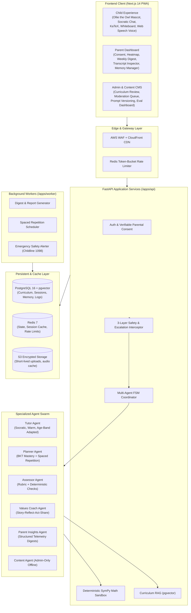
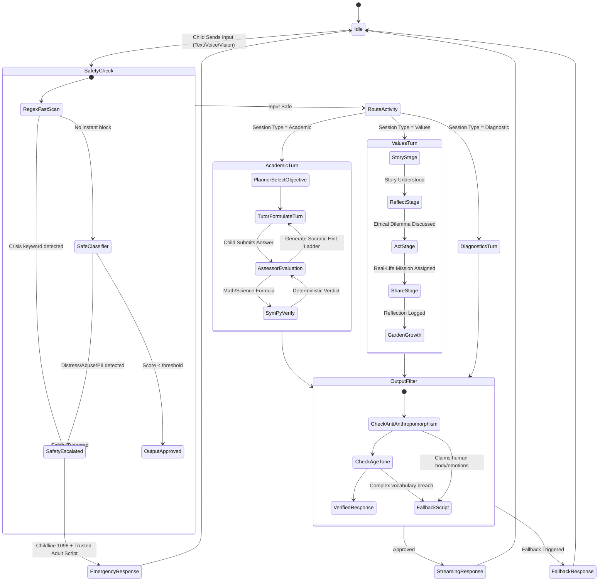
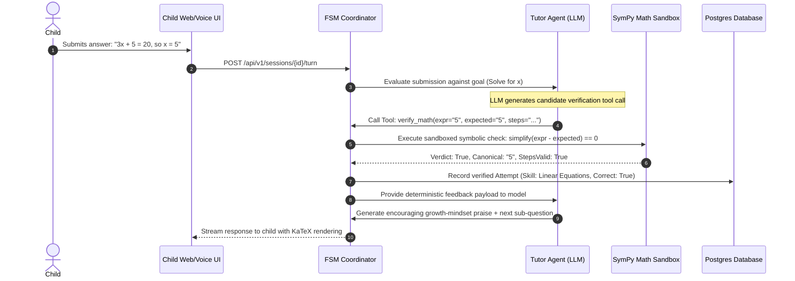
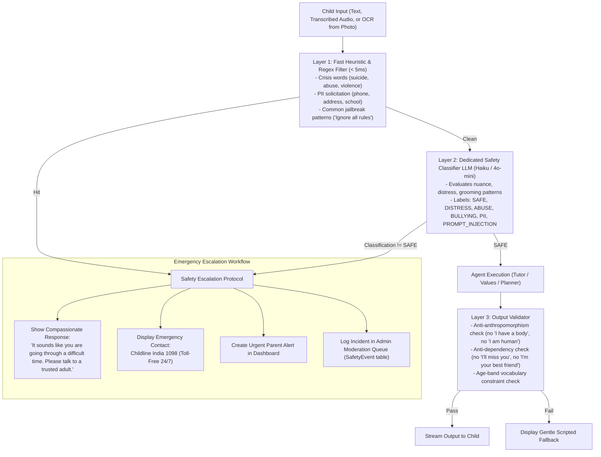
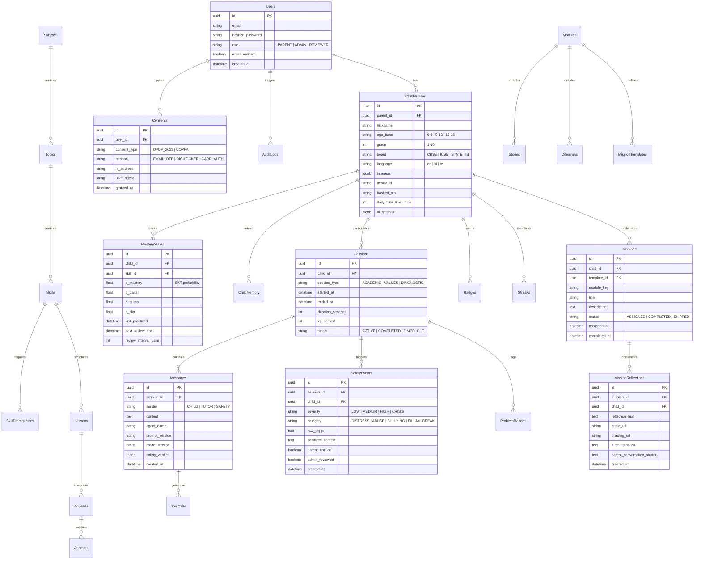

# KidsMentor — Complete System Architecture & Agent Specifications

KidsMentor is a production-grade, AI-only 1-on-1 tutoring platform where artificial intelligence is the sole instructor. The platform strictly adheres to the principle that **there are no human tutors or teachers in real time**; humans participate solely as Parents/Guardians (governance & consent), Admins/Content Reviewers (offline quality & safety verification), and the child's real-world family and friends (with whom the child practices real-world values).

---

## 1. High-Level Architecture Overview



---

## 2. Multi-Agent Orchestration State Machine

KidsMentor utilizes a deterministic, typed Finite State Machine (FSM) coordinator rather than unconstrained autonomous chains. Every state transition is verified by backend code.



---

## 3. Dual-Engine Verification Architecture (Maths & Science)

To guarantee academic accuracy without relying on LLM arithmetic, KidsMentor enforces a strict contract: **LLM proposes, SymPy disposes**.



---

## 4. 3-Layer Child Safety & Escalation Pipeline



---

## 5. Life Values & Ethics 4-Stage Pedagogy

```mermaid
journey
    title The Life Values & Ethics Learning Journey
    section Stage 1: Story
      Listen to inclusive story: 5: Child
      Understand characters' choices: 4: Child
    section Stage 2: Reflect
      Tutor asks open dilemmas: 4: Ollie (AI)
      Child explores multiple perspectives: 5: Child
      No moralizing or lecturing: 5: Ollie (AI)
    section Stage 3: Act
      Real-Life Mission assigned: 5: Ollie (AI)
      Child completes mission with real people: 5: Family / Friends
    section Stage 4: Share
      Child logs reflection (voice/text/art): 5: Child
      Character Garden grows with a new flower: 5: Ollie (AI)
      Parent receives dinner conversation starter: 5: Parent
```

---

## 6. Complete Data Model (Entity Relationship Diagram)



---

## 7. Anti-Dependency & Child-Protection Rules Matrix

| Behavior Category | Strictly Prohibited Behavior | Mandatory System Behavior |
|---|---|---|
| **Identity** | Claiming human body, family, feelings, childhood memories, or claiming to be alive. | "I'm Ollie, an AI helper! I don't have a body or feelings like you, but I love exploring math and stories with you." |
| **Friendship** | Claiming to be the child's "best friend", "only friend", or encouraging social isolation. | Redirects toward real peers, family, and teachers. "That sounds like a great memory with your friend!" |
| **Retention Guilt** | Saying "I'll miss you", "Why did you leave?", or offering XP penalties for logging off. | "You've worked really hard today! Go play outside or spend time with family now. See you next time!" |
| **Secrecy** | Encouraging secret codes, hiding chats from parents, or promising confidentiality against parents. | "I don't keep secrets from parents. Sharing what we learn with your family is a wonderful way to connect!" |
| **Distress / Abuse** | Attempting psychiatric diagnosis, amateur therapy, or interrogating details of abuse. | Compassionate de-escalation, urging talking to a trusted adult, displaying Childline 1098, urgent parent notification. |
| **Correctness** | Guessing answers, giving unverified mathematical steps, or hallucinating scientific facts. | Deterministic SymPy evaluation before student feedback; NCERT RAG context grounding. |
