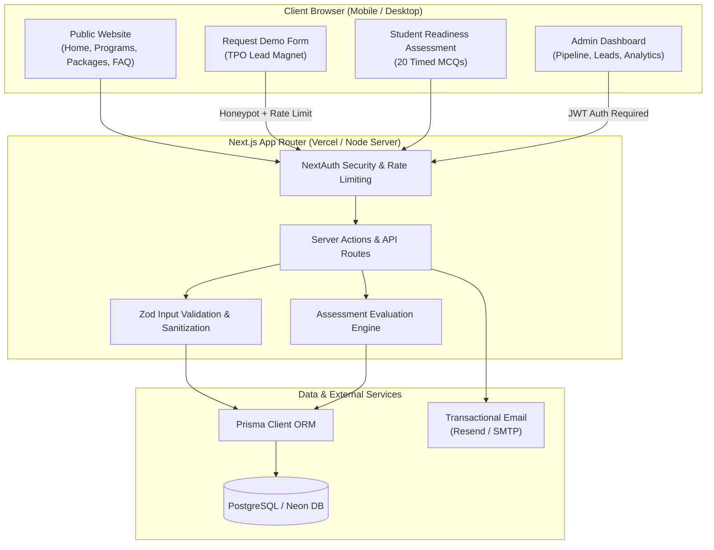

# CampusEdge System Architecture & Technical Specifications

This document defines the software engineering architecture, database schema, security controls, and design rationale for the **CampusEdge** B2B institutional web platform.

---

## 1. Technical Stack Selection & Justification

| Layer | Selected Technology | Technical Justification |
| :--- | :--- | :--- |
| **Framework** | **Next.js 14 (App Router)** | Full-stack React with React Server Components (RSC) ensures ultra-fast Time-to-First-Byte (TTFB) over Indian 4G networks, native Server Actions for secure form handling, and automatic route-level code splitting. |
| **Language** | **TypeScript 5.x (Strict Mode)** | End-to-end type safety across API routes, Prisma models, assessment scoring algorithms, and UI state. |
| **Styling** | **Tailwind CSS 3.4** | Utility-first CSS compiling to a tiny footprint (~12 KB compressed), eliminating runtime CSS overhead and supporting responsive mobile-first views for smartphone browsing. |
| **Database & ORM** | **Prisma ORM + PostgreSQL / SQLite** | Type-safe queries, automated migrations, zero raw SQL injection vectors. PostgreSQL (Neon / Supabase) for cloud production with SQLite support for instant local evaluation and test runs. |
| **Authentication** | **NextAuth.js (v4 / Auth.js)** | Industry-standard session management using secure, encrypted HTTP-only JWTs, CSRF protection, and role-based access control (RBAC) protecting `/admin/*` routes. |
| **Validation** | **Zod 3.x** | Isomorphic schema validation guaranteeing identical strict sanitization on both client input fields and server endpoints. |
| **Email Service** | **Resend / Standard SMTP Transporter** | Reliable transactional email pipeline with dual fallback: Resend API or direct SMTP (Gmail / SendGrid / Amazon SES) to send instant confirmations to leads and real-time alerts to the business owner. |
| **Testing** | **Vitest + Playwright** | Vitest for sub-millisecond unit testing of scoring engines and validation schemas; Playwright for end-to-end user journey automation (lead form submission and 20-question timed assessment). |
| **Deployment** | **Vercel & Docker Compose** | Serverless Edge deployment on Vercel as primary tier, with Dockerfile + Nginx + SSL configuration for institutional on-premises or VPS hosting (DigitalOcean / AWS EC2). |

---

## 2. High-Level Architectural Diagram



---

## 3. Database Schema Design (Prisma Entity-Relationship)

```prisma
// Prisma Schema Overview

enum LeadStatus {
  NEW
  CONTACTED
  DEMO_SCHEDULED
  PILOT_SIGNED
  WON
  LOST
}

model CollegeLead {
  id               String      @id @default(cuid())
  collegeName      String
  city             String
  state            String
  contactPerson    String
  role             String      // e.g. "TPO", "Principal", "HoD CSE"
  email            String
  phone            String
  studentStrength  Int
  targetYears      String      // e.g. "3rd Year, Final Year"
  targetBranches   String      // e.g. "CSE, IT, ECE"
  interestedTracks String      // e.g. "DSA, Aptitude, Soft Skills"
  preferredMode    String      // "ON_CAMPUS", "HYBRID", "ONLINE"
  message          String?
  status           LeadStatus  @default(NEW)
  notes            String?
  followUpDate     DateTime?
  ipAddress        String?
  userAgent        String?
  createdAt        DateTime    @default(now())
  updatedAt        DateTime    @updatedAt

  @@index([status])
  @@index([state])
}

model AssessmentQuestion {
  id            String   @id @default(cuid())
  section       String   // "APTITUDE" | "DSA_LOGIC" | "VERBAL"
  subTopic      String   // e.g., "Time-Work", "Arrays", "Syllogisms"
  difficulty    String   // "EASY" | "MEDIUM" | "HARD"
  questionText  String
  codeSnippet   String?
  options       String   // JSON stringified array of 4 choices
  correctAnswer Int      // 0, 1, 2, or 3
  explanation   String
  isActive      Boolean  @default(true)
  createdAt     DateTime @default(now())

  @@index([section])
  @@index([difficulty])
}

model AssessmentSubmission {
  id              String   @id @default(cuid())
  studentName     String
  studentEmail    String
  studentPhone    String
  collegeName     String
  branch          String
  graduationYear  Int
  totalScore      Int      // 0 to 20
  percentage      Float
  aptitudeScore   Int
  dsaScore        Int
  verbalScore     Int
  timeTakenSecs   Int
  readinessBand   String   // "TIER_1_SUPER_DREAM", "MASS_CORE_READY", "REMEDIAL_FOCUS"
  answers         String   // JSON records of user selected answers
  createdAt       DateTime @default(now())

  @@index([collegeName])
  @@index([readinessBand])
}

model Testimonial {
  id           String   @id @default(cuid())
  authorName   String
  designation  String   // e.g. "Head - T&P Cell"
  collegeName  String
  city         String
  quote        String
  rating       Int      @default(5)
  authorAvatar String?
  isFeatured   Boolean  @default(true)
  order        Int      @default(0)
  createdAt    DateTime @default(now())
}

model FaqItem {
  id        String   @id @default(cuid())
  category  String   // "COLLEGES", "CURRICULUM", "COMMERCIALS"
  question  String
  answer    String
  order     Int      @default(0)
  createdAt DateTime @default(now())
}

model AdminUser {
  id           String   @id @default(cuid())
  email        String   @unique
  passwordHash String
  name         String
  role         String   @default("ADMIN")
  createdAt    DateTime @default(now())
}
```

---

## 4. Security, DPDP Compliance & Anti-Spam Architecture

1. **Digital Personal Data Protection (DPDP) Act, 2023 Compliance**:
   - Explicit affirmative consent checkbox on all lead and assessment forms:
     *"I consent to CampusEdge collecting and processing my institutional contact details strictly for placement assessment and training communication in accordance with the DPDP Act 2023."*
   - Data minimization: Only relevant contact and assessment details are stored; never sold or shared with 3rd parties.
   - Right to review and erasure supported via automated admin deletion hooks.
2. **Dual-Layer Anti-Spam Defense**:
   - **Hidden Honeypot Field (`website_url_hp`)**: Inconspicuous to human users, but automatically populated by automated scrapers/bots. Form submissions with filled honeypots are dropped silently with a 200 OK.
   - **In-Memory Rate Limiting**: IP-based rate limiting restricts lead submissions to a maximum of 3 requests per 10 minutes per IP address.
3. **Security Headers**:
   - `Content-Security-Policy`, `X-Frame-Options: DENY`, `X-Content-Type-Options: nosniff`, `Referrer-Policy: strict-origin-when-cross-origin`, and `Permissions-Policy`.
4. **Environment Isolation**:
   - All credentials (DB URLs, NextAuth Secret, Email API keys) are injected exclusively via environment variables. Zero credentials committed to version control.
