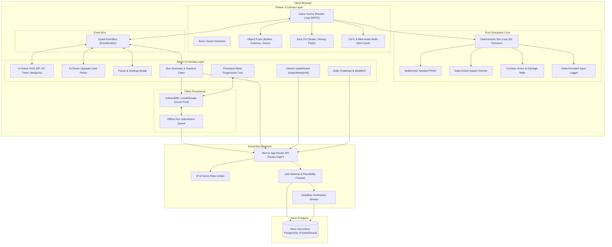
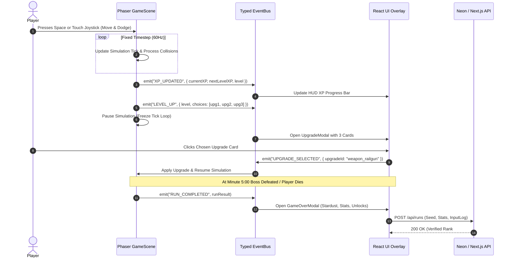
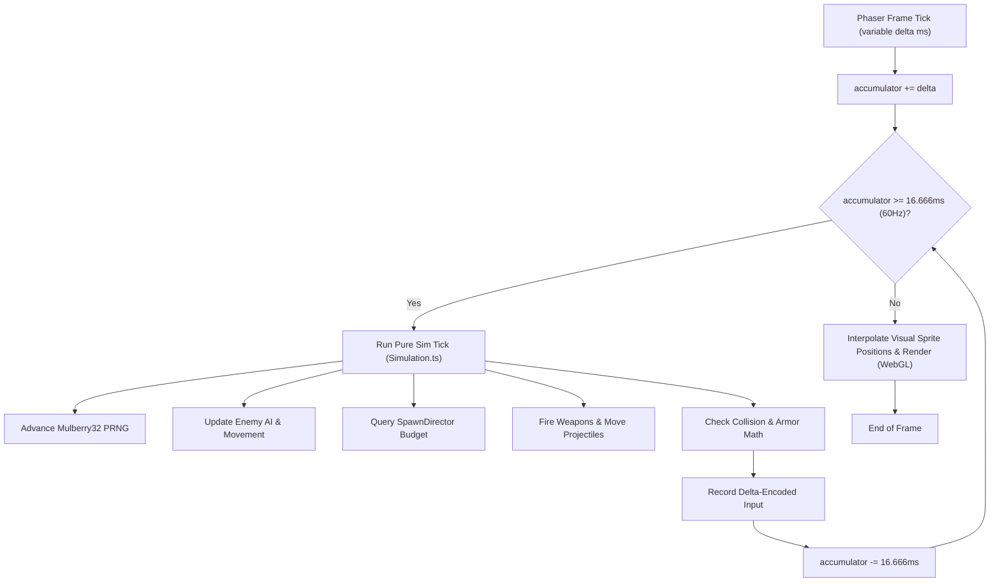
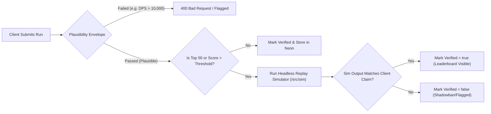

# Starfall Survivors — Architecture & System Design (ARCHITECTURE.md)

This document describes the high-level architecture, module boundaries, data flows, communication protocols, and simulation loop of **Starfall Survivors**.

---

## 1. System Overview & Layered Architecture

Starfall Survivors decouples high-frequency arcade gameplay from reactive user interface and backend persistence.



---

## 2. Directory Structure & Module Boundaries

```
starfall-survivors/
├── .github/
│   └── workflows/
│       └── ci.yml               # Lint, Typecheck, Unit Tests, Sim Replay, Playwright
├── docs/
│   ├── ARCHITECTURE.md          # This document
│   ├── DECISIONS.md             # Architecture Decision Records
│   ├── DEPLOY.md                # 0-to-Live deployment guide (Git + Neon + Vercel)
│   ├── CONTENT_GUIDE.md         # Content authoring handbook (JSON schemas)
│   ├── BALANCING.md             # Balance philosophy, power curves, weapon tiers
│   ├── ASSET_LICENSES.md        # Asset attribution & license compliance
│   ├── PLAYTEST.md              # 20-item QA & device matrix checklist
│   ├── PRIVACY.md               # Privacy policy & data retention spec
│   ├── RUNBOOK.md               # Neon wake-up, rollbacks, admin moderation
│   └── LAUNCH_CHECKLIST.md      # Launch readiness & cost projections
├── public/
│   ├── favicon.ico
│   ├── manifest.json            # PWA manifest
│   ├── sw.js                    # Service worker for offline asset caching
│   └── icons/                   # App icons (192x192, 512x512)
├── scripts/
│   ├── simulate.ts              # Headless balance bot (1,000 runs evaluator)
│   └── seed.ts                  # Neon database seeder
├── src/
│   ├── app/                     # Next.js App Router (Pages, Layouts, API Routes)
│   │   ├── api/
│   │   │   ├── daily/route.ts       # Daily challenge seed & modifier rotation
│   │   │   ├── leaderboard/route.ts # Filtered & paginated leaderboard entries
│   │   │   ├── og/route.tsx         # Dynamic OpenGraph run summary card generator
│   │   │   ├── player/route.ts      # Nickname reservation & JWT token issue
│   │   │   ├── report/route.ts      # Cheater report submission
│   │   │   ├── runs/route.ts        # Run submission & plausibility validation
│   │   │   └── save/route.ts        # Cloud save synchronization
│   │   ├── globals.css          # Tailwind directives & cosmic theme variables
│   │   ├── layout.tsx           # Root HTML layout, font setup, analytics
│   │   └── page.tsx             # Main Game Shell & React UI Overlay Container
│   ├── components/              # React UI overlay components
│   │   ├── AchievementToast.tsx # Non-intrusive achievement unlock toast
│   │   ├── DailyChallengeModal.tsx
│   │   ├── GameOverModal.tsx    # Run stats, Stardust earned, action nudges
│   │   ├── HUD.tsx              # Player HP, XP level, timer, kill counter
│   │   ├── LeaderboardModal.tsx # Daily / Weekly / All-Time leaderboards
│   │   ├── MetaShopModal.tsx    # Stardust 25-node upgrade skill tree
│   │   ├── PauseModal.tsx       # Resume, audio sliders, accessibility
│   │   ├── SettingsModal.tsx    # Keybindings, colorblind safe, reduced motion
│   │   ├── UpgradeModal.tsx     # 3-choice upgrade card selector
│   │   └── VirtualJoystick.tsx  # Dynamic floating left-thumb mobile control
│   ├── data/                    # Pure data configurations (Data-Driven Gameplay)
│   │   ├── achievements.ts      # 30 achievement conditions & reward badges
│   │   ├── arenas.ts            # 3 cosmic arenas (palettes, hazards, music stems)
│   │   ├── characters.ts        # 3 playable characters (stats & passives)
│   │   ├── dailyModifiers.ts    # Daily challenge modifier rotation definitions
│   │   ├── enemies.ts           # 10 enemy archetypes + 2 epic boss profiles
│   │   ├── metaTree.ts          # 25 permanent Stardust progression nodes
│   │   ├── passives.ts          # 12 passive item upgrades
│   │   ├── waves.ts             # Spawn director budget curves (0:00 to 5:00)
│   │   └── weapons.ts           # 8 weapons + 8 evolved weapon recipes
│   ├── db/                      # Neon Postgres + Drizzle ORM
│   │   ├── index.ts             # Neon client (pooled connection for serverless)
│   │   ├── migrate.ts           # Migration executor (direct unpooled connection)
│   │   └── schema.ts            # Drizzle table schemas, indexes & relations
│   ├── game/                    # Phaser 3 Game Presentation Layer
│   │   ├── audio/
│   │   │   ├── SoundEngine.ts   # ZzFX procedural audio synthesizer
│   │   │   └── MusicSynthesizer.ts # Web Audio API 4-stem adaptive cosmic synth
│   │   ├── entities/
│   │   │   ├── Boss.ts
│   │   │   ├── Enemy.ts
│   │   │   ├── FloatingText.ts
│   │   │   ├── PickupGem.ts
│   │   │   ├── Player.ts
│   │   │   └── Projectile.ts
│   │   ├── graphics/
│   │   │   └── TextureGenerator.ts # Procedural off-screen canvas vector graphics
│   │   ├── pools/
│   │   │   └── ObjectPool.ts    # Allocation-free recycling for bullets & mobs
│   │   ├── scenes/
│   │   │   ├── BootScene.ts     # Generates procedural textures & prepares audio
│   │   │   ├── GameScene.ts     # Main 60 FPS gameplay scene
│   │   │   └── MainMenuScene.ts # Title presentation scene
│   │   └── StarfallGame.ts      # Phaser.Game lifecycle wrapper & resize listener
│   ├── lib/                     # Utilities & Shared Infrastructure
│   │   ├── auth.ts              # HMAC anonymous token issuer & cookie parser
│   │   ├── EventBus.ts          # Typed event emitter connecting Phaser & React
│   │   ├── guestStorage.ts      # LocalStorage & IndexedDB guest state manager
│   │   └── rateLimit.ts         # In-memory & Neon rate limiting
│   └── sim/                     # Pure Deterministic Simulation Core (No Phaser!)
│       ├── Combat.ts            # Projectile hit detection, armor, crit math
│       ├── InputLogger.ts       # Delta-encoded input compression & replay buffer
│       ├── Mulberry32.ts        # Deterministic 32-bit PRNG
│       ├── Simulation.ts        # Fixed 60Hz tick updater
│       ├── SpawnDirector.ts     # Budget-based wave generator
│       ├── Types.ts             # Simulation domain types & interfaces
│       └── Verifier.ts          # Headless replay verification runner
└── vitest.config.ts             # Test runner configuration
```

---

## 3. Communication Protocol: Phaser <-> React Event Bus

Phaser and React communicate exclusively through a single strictly typed event bus (`EventBus.ts`):



---

## 4. Deterministic Simulation & Fixed Timestep Loop

To guarantee that gameplay is identical across 60Hz monitors, 120Hz iPad screens, and low-end smartphones, the physics and combat simulation run on an accumulator-based fixed timestep:



---

## 5. Security & Anti-Cheat Validation Funnel


