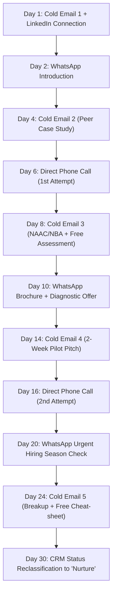

# CampusEdge 30-Day Omnichannel Prospecting Cadence

To maximize conversion with Indian engineering and degree colleges, sales reps follow a multi-channel cadence blending **Email, Phone Calls, WhatsApp, and LinkedIn** over a structured 30-day lifecycle.

---

## 30-Day Touchpoint Schedule

---

## Daily Action Checklist

| Day | Channel | Specific Action | Collateral / Template to Use |
| :-: | :--- | :--- | :--- |
| **Day 1** | **Email** | Send personalized Email 1 (Focus on Day-1 elimination rate). | `docs/outreach/COLD_EMAIL_SEQUENCE.md` (#1) |
| **Day 1** | **LinkedIn** | Send personalized connection request with peer-benchmarking note. | `docs/outreach/LINKEDIN_MESSAGES.md` (Option A) |
| **Day 2** | **WhatsApp** | Send polite intro referencing yesterday's email and offer brochure. | `docs/outreach/WHATSAPP_SCRIPTS.md` (#1) |
| **Day 4** | **Email** | Send Email 2 with peer college turnaround case study. | `docs/outreach/COLD_EMAIL_SEQUENCE.md` (#2) |
| **Day 5** | **LinkedIn** | If accepted, send direct message offering diagnostic assessment. | `docs/outreach/LINKEDIN_MESSAGES.md` (Msg 1) |
| **Day 6** | **Phone** | Place phone call between 11:00 AM – 1:00 PM (optimal TPO window). | `docs/outreach/PHONE_CALL_SCRIPTS.md` (Cold Call Flow) |
| **Day 8** | **Email** | Send Email 3 focusing on NAAC Criterion 5.1.3 and NBA Criterion 4. | `docs/outreach/COLD_EMAIL_SEQUENCE.md` (#3) |
| **Day 10** | **WhatsApp** | Share 1-page PDF brochure + pitch the subsidized 2-week pilot. | `docs/outreach/WHATSAPP_SCRIPTS.md` (#2 & #3) |
| **Day 12** | **LinkedIn** | Share 2026 Campus Placement Blueprint PDF. | `docs/outreach/LINKEDIN_MESSAGES.md` (Msg 2) |
| **Day 14** | **Email** | Send Email 4 detailing the ₹25k Pilot Offer with 100% credit guarantee. | `docs/outreach/COLD_EMAIL_SEQUENCE.md` (#4) |
| **Day 16** | **Phone** | Follow up call addressing timetable or budget hesitations. | `docs/outreach/PHONE_CALL_SCRIPTS.md` (Brush-off scripts) |
| **Day 20** | **WhatsApp** | Short voice note or message regarding upcoming batch test dates. | `docs/outreach/WHATSAPP_SCRIPTS.md` (#5) |
| **Day 24** | **Email** | Send Email 5 (Polite breakup + Free 40-Pattern Placement Cheat-sheet). | `docs/outreach/COLD_EMAIL_SEQUENCE.md` (#5) |
| **Day 30** | **CRM** | If no response, update pipeline stage to `Nurture (Next Semester)`. Re-queue outreach 60 days before next semester begins. | `docs/outreach/PROSPECT_TRACKING_TEMPLATE.csv` |

---

## Best Times to Contact Indian College Authorities

- **Tuesday to Friday, 11:00 AM – 1:00 PM**: Ideal window. Morning administrative meetings and first-period lectures have concluded, and lunch has not begun.
- **Monday Mornings (Before 11:30 AM)**: **Avoid calls**. TPOs and HoDs have mandatory department coordination meetings.
- **Friday Afternoons (3:00 PM – 4:30 PM)**: Excellent window for planning next week's demos and pilot slots.
- **Exam Windows (November–December & April–May)**: Shift focus to **Vacation Bootcamp Offers** rather than weekly integrated training.
